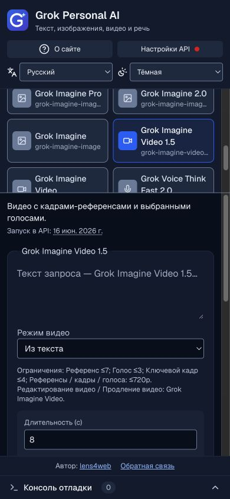

# Информация о моделях и мобильный интерфейс — 4 октября 2026

Вместо общей ссылки в разделе информации показаны короткое описание назначения модели и дата её доступности в API xAI. На мобильном экране эта же информация находится перед формой запроса. Ссылка на дату открывает официальный источник; полная документация модели остаётся в окне «О сайте».

Даты относятся к API, а не к запуску модели в потребительском приложении Grok или к последующему добавлению возможностей. Для Grok Build явно указан ранний доступ. Для Grok 4.3 подтверждённая дата запуска в просмотренных официальных источниках не найдена: интерфейс показывает «Дата не подтверждена», а не подставляет дату миграции старых моделей.

| Модель | Дата API | Источник |
| --- | --- | --- |
| Grok 4.7 | 21.09.2026 | [Release Notes](https://docs.x.ai/developers/release-notes) |
| Grok 4.6 | 12.08.2026 | [Release Notes](https://docs.x.ai/developers/release-notes) |
| Grok 4.5 | 08.07.2026 | [Release Notes](https://docs.x.ai/developers/release-notes) |
| Grok 4.3 | Не подтверждена | [Модель](https://docs.x.ai/developers/models/grok-4.3) |
| Grok 4.20 Reasoning / Non-Reasoning / Multi-Agent | 10.03.2026 | [Release Notes](https://docs.x.ai/developers/release-notes) |
| Grok Build 0.1 | 19.05.2026, ранний доступ | [Release Notes](https://docs.x.ai/developers/release-notes) |
| Grok Imagine Pro / image-quality | 06.05.2026 | [Quality Mode API](https://x.ai/news/grok-imagine-quality-mode) |
| Grok Imagine 2.0 | 07.08.2026 | [Image 2.0 API](https://x.ai/news/grok-imagine-image-2) |
| Grok Imagine / image | 28.01.2026 | [Release Notes: Next-Gen Image Generation](https://docs.x.ai/developers/release-notes) |
| Grok Imagine Video 1.5 | 16.06.2026, общий доступ | [Video 1.5 API](https://x.ai/news/grok-imagine-video-1-5) |
| Grok Imagine Video | 28.01.2026 | [Imagine API](https://x.ai/news/grok-imagine-api) |
| Voice Think Fast 2.0 | 29.07.2026 | [Release Notes](https://docs.x.ai/developers/release-notes) |
| Voice Transcribe 2.0 | 17.09.2026 | [Release Notes](https://docs.x.ai/developers/release-notes) |
| TTS | 16.03.2026 | [Release Notes](https://docs.x.ai/developers/release-notes) |

Назначения моделей переведены на все 20 языков. Даты локализуются через Intl в григорианском календаре с UTC, поэтому часовой пояс пользователя не сдвигает дату на предыдущий день.

## Мобильная верстка

Шапка на узких экранах имеет две колонки, чтобы настройки не вытесняли форму запроса. Высота страницы использует динамический viewport (`dvh`), а высота списка моделей учитывает высоту экрана. При небольшой высоте мобильного экрана список заменяется выпадающим выбором модели; настройки остаются доступны. Панель API и справка ограничены высотой экрана и прокручиваются. Авторство и обратная связь находятся над консолью отладки.

Текст, файлы и параметры принадлежат только своей модели. Новый черновик пустой, возврат восстанавливает собственный черновик; перезагрузка очищает их. Отсутствие авторизованной сессии отображается красной точкой в настройках API. Неуспешное подключение её не меняет, истечение сессии возвращает красный статус.

Проект и уведомление о личном использовании, обратная связь и подсказка о задержке логов описаны в справке. Эти тексты не отправляют обращения автоматически; ссылки открывают сайт автора и консоль xAI.

## Проверки

Прошли 79 автоматических тестов, ESLint, TypeScript в production-сборке и проверка SEO готового standalone-пакета. Дополнительный тест проверяет покрытие каталога описаниями, наличие официальных источников, корректность дат на всех локалях и отсутствие сдвига в часовом поясе America/Los_Angeles.

В браузере проверены формы всех 16 моделей на экране 320 × 568: горизонтального переполнения формы и документа нет. Шапка проверена на всех 20 языках, включая RTL. Также проверены 390 × 844 и 568 × 320, русский тёмный и арабский светлый dialog, закрытие Escape и возврат фокуса, мобильная панель API, подсказка в ошибке и переключение модели через компактный выбор. На низком альбомном экране рабочая область имеет высоту 140 px. Проверка ошибок в браузере использовала неподключённую сессию; платные обращения к xAI не выполнялись.

