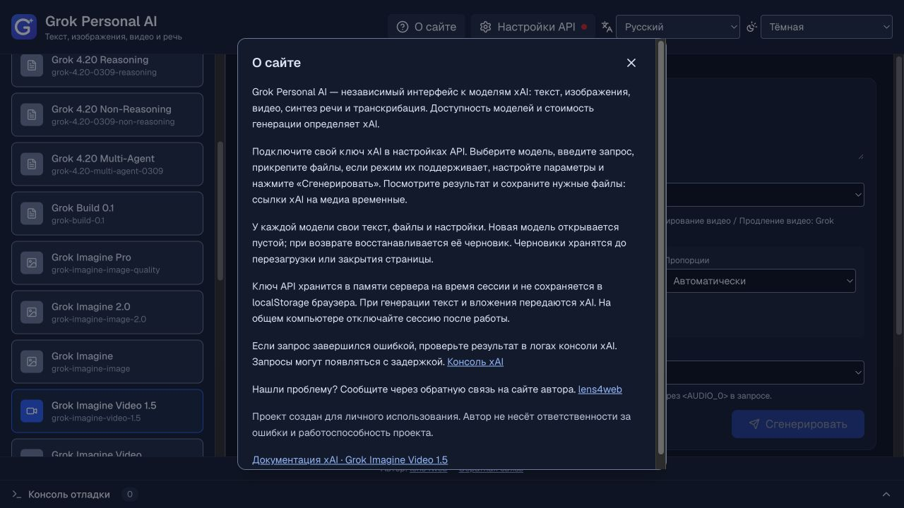

# Черновики, справка и аудит медиа — обновлено 4 октября 2026

## Результаты аудита

Проверены все 16 моделей каталога через реальные обработчики запросов/ответов с имитацией внешнего xAI fetch. Платные генерации и доступность моделей для конкретного ключа не проверялись.

| Группа | Результат |
| --- | --- |
| 3 модели изображений | Найдена та же ошибка редактирования секретов: `xai-tmp-imgen-<UUID>` в адресе файла превращался в `[redacted]`. Исправлен общий фильтр сервера и журнала браузера. Генерация и редактирование проверены с ответами URL и base64. |
| 2 видеомодели | Сохранено исправление получения MP4 через проверенное задание с авторизацией. Проверяются файл, 404, чужие задания, запрещённые хосты и отсутствие ключа в запросах к CDN. |
| 8 текстовых моделей | Текст проходит обработчик и нормализацию без повреждения. Ошибки API, неполные ответы, пустые результаты, отказ и неверный формат проверяются существующими тестами. |
| TTS | Бинарный и JSON/base64 транспорт не зависит от CORS медиа-CDN. Добавлено отклонение некорректного base64 до успешного результата, ограничено чтение бинарного аудио 256 MiB. MP3/WAV воспроизводятся, RAW скачивается. |
| STT | Транскрипция возвращается через JSON сайта; проверяются multipart и сохранность текста. |
| Realtime | Эфемерный токен передаётся отдельно от основного ключа, PCM превращается в WAV. Ошибки, закрытие WebSocket и отмена проверяются существующими тестами. |

Официальные примеры адресов: [REST API Images](https://docs.x.ai/developers/rest-api-reference/inference/images), [Video Generation](https://docs.x.ai/developers/model-capabilities/video/generation).

## Изображения

Ответ URL теперь загружается на сервере до отправки результата клиенту. Разрешены HTTPS-хосты imgen.x.ai и files-cdn.x.ai без credentials или нестандартного порта. URL берётся только из ответа xAI; пользователь не может подставить произвольный адрес. CDN не получает ключ, редиректы запрещены, есть таймаут 120 с и проверка фактически прочитанного размера. Поддерживаются PNG/JPEG/WebP, проверяются сигнатуры; HTML, пустые файлы и ошибочный base64 не считаются успешным результатом. Лимиты — 25 MiB на изображение, 50 MiB на весь результат.

Клиент получает содержимое файлов и создаёт локальные Blob URL для всех изображений, независимо от выбранного формата ответа API. Поэтому показ, скачивание и открытие не зависят от CORS CDN. Все Blob URL освобождаются при смене результата, модели или закрытии компонента, включая частично полученные результаты при ошибке. Ошибка декодирования изображения, аудио или видео отображается в интерфейсе и журнале. Исходная временная ссылка первого изображения доступна через «Копировать», если API вернул URL.

## Черновики моделей

Для каждой модели в памяти открытой страницы сохраняются текст запроса, вложения, параметры (в том числе системные инструкции), видеорежим, голоса и request_id. При первом выборе новой модели её текст и вложения пусты. Никакие поля не копируются из предыдущей модели. Возврат к уже использованной модели восстанавливает её собственный черновик. Параметры и вложения не переносятся в другую модель, поэтому её ограничения остаются независимыми.

При переключении локальное ожидание/чтение файлов прекращается; уже принятые xAI видеозадания могут продолжать выполняться. Готовые результаты освобождаются при смене модели. Перезагрузка или закрытие страницы очищает черновики: они не записываются в localStorage, IndexedDB или cookie. Смена видеорежима по-прежнему очищает вложения/голоса, чтобы не смешивать несовместимые типы входа; текст остаётся.

## Справка и проверки

Кнопка «О сайте» в шапке открывает нативный модальный dialog с описанием сайта, порядком работы, поведением черновиков, обращением с ключом и ссылкой на документацию выбранной модели. Все новые тексты переведены на 20 языков. Диалог имеет доступное название, ограниченную высоту и прокрутку; Escape закрывает его, фокус возвращается на кнопку.

При первоначальной проверке 3 октября прошли 78 автоматических тестов, ESLint, TypeScript и production-сборка. В браузере подтверждены независимые тексты Grok 4.7/4.6, восстановление PNG-вложения и reasoning low у 4.7, сохранение текста/режима references/голоса Iris/длительности 3 с/request_id у Video 1.5. После обновления 4 октября перенос текста убран: в браузере проверены пустые поля и отсутствие чужого изображения при первом выборе Grok 4.6 и Video 1.5, восстановление собственного текста 4.6 и текста/PNG-вложения 4.7, очистка при перезагрузке страницы. Проверены тёмная русская справка, светлая арабская справка при ширине 390 px, отсутствие горизонтального переполнения, Escape и возврат фокуса. Тесты ответов xAI используют имитацию, а не подтверждают платную генерацию каждым модельным сервисом.

Справка дополнена ссылкой на автора, обратной связью, уведомлением о личном использовании и подсказкой о задержке появления запросов в логах консоли xAI. Подсказка также видна рядом с ошибкой результата. Все новые сообщения переведены на 20 языков. См. [информацию о моделях и мобильную верстку](MODEL_INFO.md).
