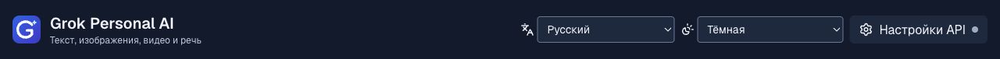
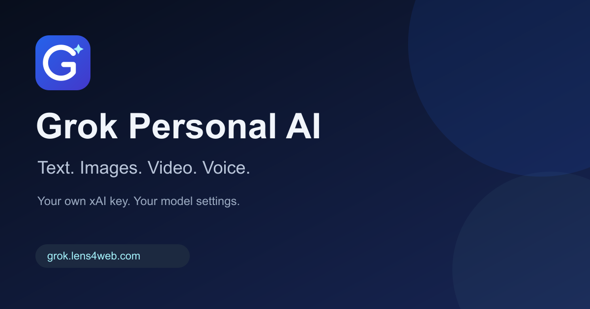

# Значок и поисковая оптимизация — 2 октября 2026

## Значок

Собственный знак Grok Personal AI: геометрическая белая G с голубой искрой на сине-фиолетовом фоне. Векторный оригинал — `src/app/icon.svg`; из него командой `npm run assets` создаются все растровые варианты. Знак используется в шапке, вкладках браузера, ярлыках устройств и карточке ссылки. Это оформление интерфейса, а не официальный логотип xAI.

- `favicon.ico`: кадры 16/32/48/64/256 px, вместо стандартного значка Next.js.
- SVG для браузеров и PNG 96×96 для поисковых систем.
- Apple touch icon 180×180 без прозрачного фона.
- Иконки приложения 192/512 px, отдельная непрозрачная maskable 512×512 с отступами для безопасного обрезания.
- Open Graph / Twitter preview 1200×630: `public/social-card.png`.

Next.js автоматически формирует link-теги по файловым соглашениям App Router. Manifest содержит название, стартовый URL, цвета и иконки ярлыка; service worker и офлайн-режим не добавлены.

## SEO

До обновления публичная главная отвечала HTTP 200, но содержала общее английское описание и стандартную favicon. Canonical, Open Graph/Twitter, sitemap, robots.txt и manifest отсутствовали в проекте.

Добавлены:

- Локализованные title и description на 20 языках. Они формируются на сервере с учётом preference cookie и Accept-Language; назначение приложения также видно в подзаголовке шапки.
- Фиксированный публичный `metadataBase` и canonical на `https://grok.lens4web.com/`. Host-заголовок запроса не определяет публичную URL. Общий источник — `SITE_URL` в `src/lib/site.ts`.
- Open Graph и Twitter summary_large_image с абсолютной URL изображения, размерами и alt.
- JSON-LD WebSite с названием, URL и языком; тег получает CSP nonce, данные экранируются. Рейтинги, отзывы и цены не выдуманы.
- `robots.txt` разрешает главную и её ресурсы, запрещает обход `/api/` и указывает sitemap.
- `sitemap.xml` перечисляет единственную реальную публичную страницу. Ненастоящие даты lastmod не добавлены.
- API дополнительно возвращает `X-Robots-Tag: noindex, nofollow`; контроль доступа через серверную сессию остаётся обязательным.
- Семантический main и единственный h1 в шапке.

Языки и модели переключаются на одной URL. Поэтому отдельные языковые URL и hreflang не объявлены. Для независимой индексации каждого языка потребуются отдельные маршруты с соответствующим содержимым. Создание статей/посадочных страниц, подключение Search Console, отправка sitemap в поисковые системы и проверка позиций не выполнялись.

См. первичные рекомендации Google: [favicon](https://developers.google.com/search/docs/appearance/favicon-in-search), [noindex](https://developers.google.com/search/docs/crawling-indexing/block-indexing), [JavaScript SEO](https://developers.google.com/search/docs/crawling-indexing/javascript/javascript-seo-basics). Robots.txt не является защитой секретов; API защищено авторизацией. Соответствие техническим требованиям не гарантирует позиции или немедленное появление значка в выдаче.

## Проверка

`npm run test:seo` запускается против работающего production-сервера. По умолчанию это `http://127.0.0.1:3002`; изменить адрес можно через `SEO_TEST_ORIGIN`. Скрипт не требует ключа и не запускает генерацию. Проверяется реальный HTML для английского, русского и арабского social crawler: метаданные в head, canonical, социальные теги, иконки, язык, JSON-LD/CSP nonce и семантические элементы. Проверяются ответы robots/sitemap/API, manifest, размеры и непрозрачность maskable, social card и структура всех ICO-кадров. Этот шаг добавлен в smoke-проверку standalone-сборки GitHub Actions до загрузки релиза на сервер.

Результаты: 54 API-теста, ESLint, TypeScript, production-сборка и SEO smoke-проверка успешно пройдены. В браузере проверены тёмная шапка на русском и светлый арабский интерфейс при ширине 390 px: значок загружается, горизонтального переполнения и ошибок консоли нет.

