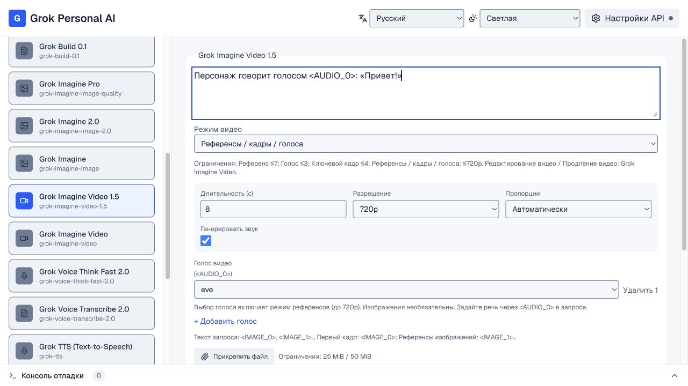
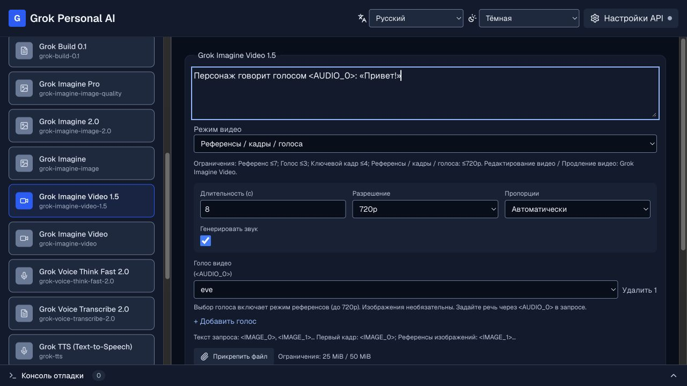
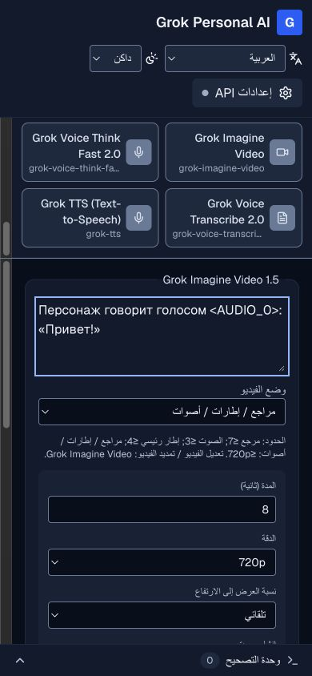

# Языки, темы и безопасность — 2 октября 2026

## Интерфейс

Добавлены 20 полных словарей интерфейса: en, ru, es, fr, de, pt, it, zh, ja, ko, ar, hi, bn, tr, id, vi, th, uk, fa, ur. Проверяются наличие каждой строки во всех языках, перевод подписей параметров всех 16 моделей, сохранность маркеров `<AUDIO_0>` и региональные языковые настройки. Китайский перевод использует упрощённые иероглифы. Региональные варианты выбирают основной язык (например, pt-BR → pt); неподдерживаемый язык выбирает следующий поддерживаемый язык браузера или английский.

Первый ответ сервера использует `Accept-Language`; после загрузки браузера автоматический режим использует `navigator.languages`. Тема по умолчанию следует системному `prefers-color-scheme`, включая последующие изменения. Ручной выбор хранится в localStorage и cookies **только как язык/тема**. Cookies позволяют серверу сразу отдать правильный язык и палитру. При блокировке хранилища работают системные настройки и выбор на текущей странице.

Переведены настройки моделей, кнопки, подсказки, режимы видео, роли референсов, справка о голосах, единицы цены, диалог API и журнал. Названия моделей, идентификаторы голосов и значения протокола сохраняются. Технические ошибки показаны в раскрываемом разделе на исходном языке; содержимое генерации автоматически не переводится. Язык интерфейса не меняет параметры языка синтеза/транскрибации. Переключение языка или темы сохраняет введённый запрос и параметры модели.

Обе палитры используют общие семантические цвета. Тест рассчитывает контраст всех цветов обычного текста на трёх поверхностях (не ниже 4,5:1), границ полей (не ниже 3:1). В браузере проверены светлая/тёмная темы, переключение всех языков, сохранение предпочтений после перезагрузки, RTL и формы на ширине 390 px. Диалог API использует нативный focus trap и закрытие Escape; у интерактивных элементов есть видимый keyboard focus. Широкие сетки параметров на мобильном экране превращаются в одну колонку.

## Хранение ключа

1. Пользователь вводит собственный ключ в password-поле. Подключение выполняется по HTTPS на сервер приложения.
2. Сервер проверяет ключ через [список моделей xAI](https://docs.x.ai/developers/rest-api-reference/inference/models), не отправляя запрос генерации. Неверный ключ не создаёт сессию. Ошибка проверки не возвращает содержимое ответа авторизации xAI.
3. В памяти единственного Node-процесса ключ связан с криптографически случайным 256-битным ID. Срок сессии — 8 часов без автоматического продления. Истечение, отключение и перезапуск сервера удаляют доступ к сессии.
4. Браузер получает HttpOnly / SameSite=Strict cookie; в HTTPS это Secure cookie `__Host-grok_session` с Path=/ и без Domain. JavaScript страницы не читает cookie. Ключ не возвращается в API-ответах, не сохраняется в localStorage и не попадает в журнал. Поле очищается после попытки подключения и закрытия диалога.
5. Старый `xai_api_key` удаляется из localStorage. Требуется подключить ключ заново; автоматический импорт старого секрета не выполняется.

Для Realtime браузер получает предназначенный для WebSocket временный токен xAI, а не основной ключ. Его нельзя сделать HttpOnly, поскольку он нужен браузерному голосовому клиенту; отключение локальной сессии не отзывает уже выданный upstream-токен. Он действует ограниченное время согласно параметрам xAI.

Сервер приложения — доверенная сторона: администратор/скомпрометированный процесс может получить ключ из памяти. HttpOnly защищает чтение session cookie кодом страницы, но не предотвращает использование сессии при выполнении вредоносного кода в том же origin. Расширения браузера и компрометация устройства также выходят за пределы защиты приложения. Поэтому обещать «ключ невозможно украсть» технически нельзя. Передавайте ключ только серверу, которому доверяете. [OWASP объясняет риск хранения секретов в localStorage](https://cheatsheetseries.owasp.org/cheatsheets/HTML5_Security_Cheat_Sheet.html).

## Контроль запросов

- API требует действующую серверную сессию. Передача браузерного `Authorization: Bearer` больше не даёт доступ.
- Проверяются точный публичный origin, `Sec-Fetch-Site` и обязательный пользовательский заголовок `X-Grok-Request`. Чужие origin, запросы без заголовка, угаданные и отозванные сессии отклоняются до xAI. CORS-доступ сторонним сайтам не открыт.
- В production отсутствие `APP_ORIGIN` блокирует API. Публичный origin должен быть HTTPS; localhost допускает HTTP для локальной проверки.
- Задание видео проверяется только в сессии, которая его создала. Ручное продолжение по request_id работает в той же сессии, включая перезагрузку страницы, но после отключения/перезапуска/истечения старые задания не доступны через этот прокси. Они могут продолжать выполняться у xAI.
- На процесс: максимум 20 попыток подключения в минуту, 1000 сессий и 4 одновременно обрабатываемых POST генерации. На сессию: 100 API-запросов в минуту, 12 запусков в минуту и 2 одновременно обрабатываемых POST. Это число активных HTTP-запросов, а не длительно выполняющихся заданий xAI.
- Сохраняются ID максимум 100 видео-заданий на сессию; после этого нужна новая сессия для новых видео. Другие модели продолжают работать. Повторная генерация ограничивается отдельно, но эти локальные лимиты не заменяют бюджет/квоты xAI.
- Тело запроса ограничено реально прочитанными байтами: 1 КиБ при подключении и 72 МиБ для генерации, даже без `Content-Length`. Зависшая загрузка обрывается через 15 секунд для ключа и 2 минуты для генерации. Вложения дополнительно проверяются общими правилами 25/50 МБ. Произвольный upstream endpoint и несовместимые параметры не принимаются.
- Основной ключ отправляется только на фиксированный `https://api.x.ai/v1`; redirects запрещены. Ключи, bearer-строки и поля токенов скрываются в обычных ответах и журнале.

CSP использует новый nonce для каждой страницы, запрещает произвольные inline-скрипты, объекты и фрейминг. Production не разрешает `unsafe-eval`. Установлены nosniff, frame protection, no-referrer и HSTS для HTTPS. Markdown не исполняет HTML, внешние ссылки открываются с noopener/noreferrer, Markdown-картинки не загружаются автоматически. Медиа-результаты проверяются на допустимые URL/типы; executable data URL, SVG и URL с credentials отклоняются.

## Аналитика

В production подключён предоставленный Umami-скрипт с индивидуальным CSP nonce; разрешение сетевых запросов добавлено только для `https://pulse.lens4web.com`. Отслеживается домен `grok.lens4web.com`, dev/localhost исключены. Приложение не передаёт в аналитику ключи, формы, промпты или результаты; параметры URL/hash исключены, Do Not Track соблюдается. Скрипт аналитики выполняется в контексте страницы и является доверенной сторонней зависимостью: CSP nonce разрешает его выполнение, а не изолирует его доступ к DOM. Обновления скрипта контролируются сервером Umami.

## Развёртывание

Нужны Node.js 20.9+, **один постоянно работающий процесс**, HTTPS и `APP_ORIGIN=https://ваш-домен`. HTML/API нельзя кэшировать. Установите лимит тела reverse proxy не ниже 75 MiB и таймауты под используемые модели (Responses до часа, TTS до 10 минут). Статичный хостинг и несколько реплик без общего хранилища сессий не поддерживаются. Общий ключ администратора не встроен: каждому посетителю нужен свой действующий ключ. Если нужен закрытый сервис с общим ключом, требуется отдельная аутентификация пользователей и контроль бюджета; текущая конфигурация этого не заявляет.

## Проверки и пределы проверки

Все **54 автотеста** прошли. Они используют моделированные ответы xAI и проверяют транспорт моделей, авторизацию, запрет чужих запросов/видео, истечение/отзыв сессии, ограничение размера, редактирование секретов, CSP, словари и контраст. Выполнены lint, TypeScript и production-сборка. Браузерная проверка охватывает desktop/mobile, RTL, смену и сохранение языка/темы, сохранение формы, диалог ключа и работу CSP production. Дополнительно на запущенной production-сборке подтверждены 401 без сессии/с угаданной cookie, 403 для чужого origin/без проверочного заголовка, 400 для неверного формата ключа, язык SSR из Accept-Language, совпадение nonce скриптов с CSP, уникальность nonce между страницами и no-store. Анимация смены цветов карточек убрана, чтобы мгновенное переключение не снижало контраст в промежуточном кадре.

Платная генерация и запросы с реальными ключами в этой проверке не выполнялись. Наличие переводов и интерфейсные проверки не заменяют редактуру носителями каждого языка. Нулевая уязвимость или устойчивость к полному компромиссу сервера/устройства не заявляется.

